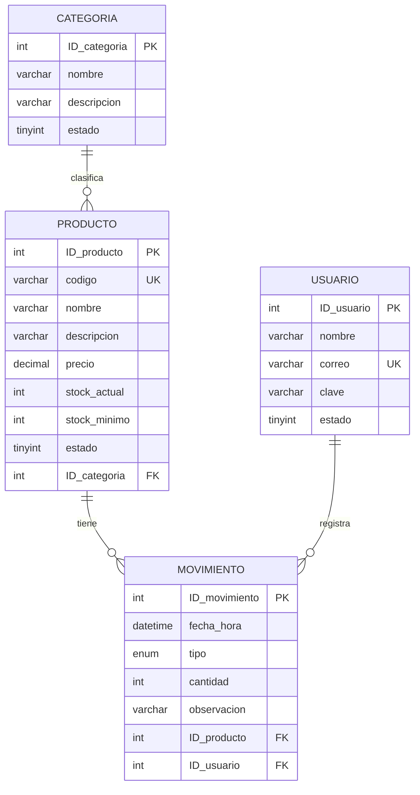

# TecnoStock – Sistema de inventario

Aplicación web para gestionar el catálogo de productos y las entradas y salidas de existencias de TecnoStock, un emprendimiento que comercializa accesorios tecnológicos.

- **Asignatura:** Taller de Sistemas de Información – Caso 1 (Sistema de inventario)
- **Autor:** Vicente Castro
- **Modalidad:** individual
- **Tecnologías:** HTML5, Bootstrap 5, JavaScript, PHP 8 (PDO), MySQL, XAMPP

---

## 1. Análisis del problema

### 1.1 Contexto

TecnoStock registra hoy sus productos en una planilla. Esto ha provocado **códigos duplicados**, **errores en las cantidades disponibles** y **poca claridad sobre el stock real**.

### 1.2 Objetivo

Construir una aplicación web sencilla, ejecutable en un servidor local, que centralice la información del catálogo, mantenga el stock actualizado a partir de los movimientos y conserve la integridad de los datos.

### 1.3 Alcance

**Incluye:**
- Inicio y cierre de sesión de un usuario previamente registrado.
- Alta, consulta, búsqueda, edición y desactivación de productos.
- Registro de entradas y salidas de existencias con actualización automática del stock.
- Alerta visual de productos con stock bajo.
- Historial de movimientos.

**No incluye** (fuera del alcance del MVP): registro de nuevos usuarios desde la interfaz, gestión de categorías desde la interfaz (se cargan en la base), reportes, múltiples roles, ventas o facturación.

### 1.4 Actor

| Actor | Responsabilidad principal |
|---|---|
| Encargado de inventario | Administra productos y movimientos de existencias. Es el único usuario del sistema. |

---

## 2. Requerimientos

### 2.1 Requerimientos funcionales

| ID | Requerimiento |
|---|---|
| RF01 | Iniciar sesión con un usuario previamente registrado. |
| RF02 | Registrar productos con código, nombre, categoría, descripción, precio, stock actual y stock mínimo. |
| RF03 | Consultar el listado de productos. |
| RF04 | Buscar productos por nombre, código o categoría. |
| RF05 | Modificar el precio, la descripción, la categoría y las cantidades de un producto. |
| RF06 | Desactivar productos que ya no se comercializan. |
| RF07 | Registrar entradas y salidas de existencias. |
| RF08 | Mostrar una alerta cuando el stock actual sea menor que el stock mínimo. |
| RF09 | _(Adicional)_ Consultar el historial de movimientos. |
| RF10 | _(Adicional)_ Cerrar sesión. |

### 2.2 Requerimientos no funcionales

| ID | Requerimiento |
|---|---|
| RNF01 | Sin frameworks complejos: HTML5, Bootstrap, JavaScript y PHP puro. |
| RNF02 | Ejecución en servidor local (XAMPP: Apache, PHP y MySQL). |
| RNF03 | Acceso a datos con PDO y consultas preparadas. |
| RNF04 | Validaciones en el cliente (JavaScript) repetidas en el servidor (PHP). |
| RNF05 | Interfaz comprensible para un usuario no técnico y responsiva. |
| RNF06 | Contraseñas almacenadas con hash y páginas internas protegidas por sesión. |

### 2.3 Reglas de negocio

| ID | Regla |
|---|---|
| RN01 | El código de producto no puede repetirse. |
| RN02 | El precio, el stock actual, el stock mínimo y la cantidad de un movimiento no pueden ser negativos. |
| RN03 | Todo movimiento debe registrar fecha, tipo, cantidad, producto y usuario responsable. |
| RN04 | Una salida no puede dejar el stock bajo cero. |
| RN05 | Un producto con movimientos registrados debe desactivarse; no se elimina físicamente. |
| RN06 | El stock se actualiza automáticamente después de cada entrada o salida válida. |

---

## 3. Decisiones de diseño

Estas decisiones resuelven puntos que el enunciado deja abiertos:

1. **El stock actual solo cambia mediante movimientos.** El caso pide poder modificar "las cantidades" de un producto, pero también que el stock se actualice automáticamente con cada entrada o salida. Para que ambas condiciones sean coherentes, el formulario de edición permite modificar precio, nombre, descripción, categoría y **stock mínimo**, mientras que el **stock actual** se muestra bloqueado y se modifica únicamente registrando movimientos. Así el historial siempre explica el stock.
2. **El stock inicial queda registrado como movimiento.** Al crear un producto con stock inicial mayor a 0, el sistema registra automáticamente una entrada con la observación "Stock inicial", dentro de la misma transacción.
3. **La cantidad de un movimiento debe ser mayor a 0.** La regla pide que no sea negativa; un movimiento de 0 unidades no tiene sentido, por lo que se usa una restricción más estricta (`cantidad > 0`).
4. **El código del producto no se puede modificar** una vez creado, para proteger su unicidad y la trazabilidad.
5. **Desactivar es una baja lógica.** No existe ninguna operación `DELETE` sobre productos; un producto desactivado conserva su historial, no puede editarse ni recibir movimientos.
6. **"Stock bajo" significa estrictamente menor.** La alerta se muestra cuando `stock_actual < stock_minimo`; si el stock es igual al mínimo no hay alerta. Los productos desactivados no generan alerta.

---

## 4. Modelo de datos

### 4.1 Diagrama entidad-relación



### 4.2 Relaciones (llaves foráneas)

| Llave foránea | Referencia | Significado |
|---|---|---|
| `producto.ID_categoria` | `categoria.ID_categoria` | Una categoría tiene muchos productos. |
| `movimiento.ID_producto` | `producto.ID_producto` | Un producto tiene muchos movimientos. |
| `movimiento.ID_usuario` | `usuario.ID_usuario` | Un usuario registra muchos movimientos. |

### 4.3 Restricciones e integridad

| Restricción | Dónde | Regla que protege |
|---|---|---|
| `UNIQUE` en `codigo` | `producto` | RN01 |
| `UNIQUE` en `correo` | `usuario` | Un correo por usuario |
| `CHECK (precio >= 0)` | `producto` | RN02 |
| `CHECK (stock_actual >= 0)` | `producto` | RN02, RN04 |
| `CHECK (stock_minimo >= 0)` | `producto` | RN02 |
| `CHECK (cantidad > 0)` | `movimiento` | RN02 |
| `NOT NULL` en `ID_producto`, `ID_usuario`, `tipo`, `cantidad`, `fecha_hora` | `movimiento` | RN03 |
| `ENUM('entrada','salida')` | `movimiento.tipo` | Solo tipos válidos |
| `DEFAULT CURRENT_TIMESTAMP` | `movimiento.fecha_hora` | RN03 |
| `NOT NULL` en `ID_categoria` | `producto` | Todo producto tiene categoría |
| `estado` (baja lógica) | `producto`, `categoria`, `usuario` | RN05 |

### 4.4 Normalización

El modelo cumple la **tercera forma normal**: cada tabla representa una sola entidad, todos los atributos dependen de la clave primaria y no hay datos repetidos entre tablas (por ejemplo, el nombre de la categoría se guarda una sola vez y los productos la referencian por su identificador).

---

## 5. Trazabilidad

### 5.1 Requerimientos → implementación

| Requerimiento | Archivo(s) | Cómo se cumple |
|---|---|---|
| RF01 Iniciar sesión | `index.php`, `auth.php` | Formulario de login; `password_verify` contra el hash guardado; sesión con `$_SESSION`. |
| RF10 Cerrar sesión | `logout.php` | `session_destroy()` y redirección al login. |
| RF02 Registrar productos | `producto_form.php` | Formulario de alta con validaciones; inserción con PDO. |
| RF03 Listado | `productos.php` | `SELECT` con `JOIN` a categoría; tabla Bootstrap. |
| RF04 Búsqueda | `productos.php` | Búsqueda con `LIKE` por nombre, código o categoría, con consulta preparada. |
| RF05 Modificar | `producto_form.php` | Mismo formulario en modo edición (`?id=`); `UPDATE` preparado. El stock actual se modifica vía movimientos (ver decisión 1). |
| RF06 Desactivar | `productos.php` | `UPDATE estado = 0` con confirmación; sin `DELETE`. |
| RF07 Entradas y salidas | `movimientos.php` | Formulario de movimiento; transacción que inserta el movimiento y actualiza el stock. |
| RF08 Alerta de stock bajo | `productos.php`, `movimientos.php` | Fila roja y etiqueta "Stock bajo" en el listado; aviso al registrar un movimiento que deja el stock bajo el mínimo. |
| RF09 Historial | `movimientos.php` | Tabla con los últimos 50 movimientos (fecha, producto, tipo, cantidad, observación, usuario). |

### 5.2 Reglas de negocio → implementación

| Regla | Base de datos | Aplicación |
|---|---|---|
| RN01 Código único | `UNIQUE (codigo)` | Verificación previa y captura del error de duplicado en `producto_form.php`, con mensaje claro. |
| RN02 Sin negativos | `CHECK` en precio, stocks y cantidad | Validación en JavaScript y en PHP en ambos formularios. |
| RN03 Movimiento completo | `NOT NULL` en los campos, `DEFAULT CURRENT_TIMESTAMP` | `movimientos.php` toma el usuario desde la sesión y valida producto, tipo y cantidad. |
| RN04 Salida sin stock negativo | `CHECK (stock_actual >= 0)` como respaldo | `movimientos.php` compara la cantidad con el stock vigente (con `SELECT ... FOR UPDATE`) y rechaza la salida con un mensaje. |
| RN05 No eliminar | `estado` en `producto` | No existe ninguna instrucción `DELETE`; solo `UPDATE estado = 0`. |
| RN06 Stock automático | — | `movimientos.php` inserta el movimiento y actualiza el stock en una sola transacción (`commit` / `rollBack`). |

---

## 6. Validaciones y seguridad

| Aspecto | Implementación |
|---|---|
| Validación en el cliente | JavaScript en `producto_form.php` y `movimientos.php`, con mensajes bajo cada campo. |
| Validación en el servidor | Las mismas reglas repetidas en PHP; es la validación definitiva. |
| Inyección SQL | Consultas preparadas con PDO en todo el sistema. |
| XSS | Toda salida se escapa con `htmlspecialchars`. |
| Contraseñas | Guardadas con `password_hash` y verificadas con `password_verify`. |
| Acceso | Las páginas internas incluyen `auth.php` y redirigen al login si no hay sesión. |
| Consistencia del stock | Transacciones que aseguran que el movimiento y el cambio de stock se guardan juntos o no se guarda ninguno. |

---

## 7. Estructura del proyecto

```
tecnostock/
├── conexion.php        Conexión PDO a MySQL
├── auth.php            Protege las páginas internas (sesión)
├── header.php          Encabezado, menú y Bootstrap
├── footer.php          Cierre de página y scripts
├── index.php           Inicio de sesión
├── inicio.php          Página de bienvenida
├── logout.php          Cierre de sesión
├── productos.php       Listado, búsqueda, alerta de stock bajo y desactivación
├── producto_form.php   Registro y edición de productos
├── movimientos.php     Entradas, salidas e historial
├── sql/
│   └── tecnostock.sql  Base de datos, tablas y datos iniciales (archivo único)
├── PRUEBAS.md          Casos de prueba, datos y resultados
└── README.md
```

---

## 8. Instalación y ejecución

**Requisitos:** XAMPP con Apache, MySQL y PHP 8.

1. Copia la carpeta del proyecto en `C:\xampp\htdocs\` (por ejemplo `C:\xampp\htdocs\Tecnostock`).
2. Abre el **Panel de control de XAMPP** e inicia **Apache** y **MySQL**.
3. Importa el script `sql/tecnostock.sql`, que crea la base `tecnostock`, las tablas y los datos iniciales. Puedes hacerlo de dos formas:
   - Desde phpMyAdmin (`http://localhost/phpmyadmin`): pestaña **Importar**, estando en el inicio del servidor, sin ninguna base seleccionada.
   - Desde la terminal: `mysql -u root < sql/tecnostock.sql`
4. Revisa que `conexion.php` use `localhost`, la base `tecnostock`, usuario `root` y clave vacía (valores por defecto de XAMPP).
5. Abre `http://localhost/Tecnostock/` en el navegador.

**Usuario de prueba**

| Correo | Clave |
|---|---|
| `admin@tecnostock.cl` | `admin123` |

> Si el puerto 3306 está ocupado por otra instalación de MySQL, detén ese servicio antes de iniciar MySQL desde XAMPP.

---

## 9. Pruebas

Los casos de prueba, los datos usados y sus resultados están documentados en **`PRUEBAS.md`**.

---

## 10. Limitaciones y mejoras futuras

- La gestión de categorías y usuarios se realiza directamente en la base de datos.
- Un producto desactivado no se puede reactivar desde la interfaz.
- El historial muestra solo los últimos 50 movimientos, sin filtros.
- Mejoras posibles: filtros por fecha, producto y tipo de movimiento; reportes de stock; reactivación de productos; gestión de usuarios con distintos roles.

---

## 11. Enlaces

- **Repositorio GitHub:** _[pendiente de confirmar la URL]_
- **Video explicativo:** [TecnoStock_final.mp4](../Escritorio/edicion/tecnostock_final.mp4) (4:55, 1920×1080, 60 fps). La versión publicada en GitHub debe sustituirse por el enlace del vídeo alojado.
